# LeakTrace

Forensic exam-paper distribution and leak tracing. Every printed copy of an exam paper is made
textually unique through small, meaning-preserving variations (synonyms, optional commas, number
style, MCQ option order, question order inside a block). Each copy carries a secret combination of
choices, its *fingerprint vector*. When a paper leaks, an examiner pastes a few lines of the leaked
text into the **Trace Lab**, and LeakTrace names the exact copy, centre, room, seat and invigilator.

This is a college mini project. It runs entirely on one laptop: PostgreSQL in Docker, plus a Node API,
a background worker and a React front end. Every external service (storage, queue, scheduler,
notifications, metrics, config, worker fleet) sits behind an adapter interface with a local
implementation, so an AWS version can be swapped in later without touching business logic.
There is **no AI or ML** anywhere: every feature is deterministic code.

| | |
|---|---|
| 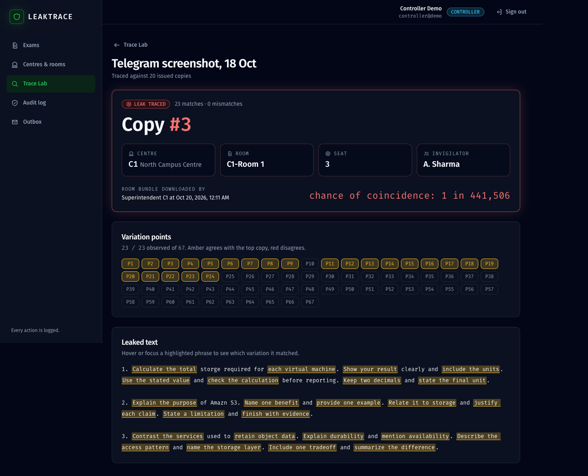 | 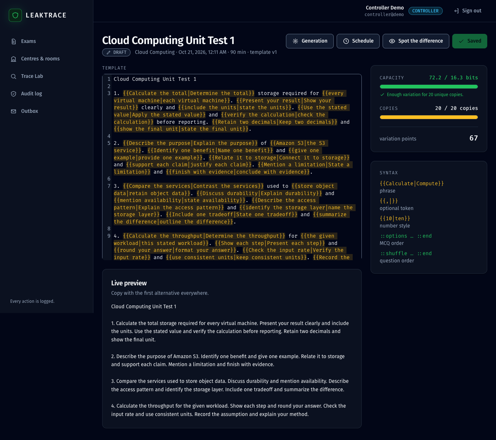 |

## Contents
- [Quick start](#quick-start)
- [Demo walkthrough](#demo-walkthrough)
- [How it works](#how-it-works)
- [Architecture](#architecture)
- [Roles](#roles)
- [API overview](#api-overview)
- [Scripts](#scripts)
- [Tests](#tests)
- [Security notes](#security-notes)
- [Troubleshooting](#troubleshooting)
- [Screenshots](#screenshots)

## Quick start

Requirements: Node 20+ (developed on 22), Docker Desktop.

```bash
git clone <this repo> && cd leaktrace
cp .env.example .env          # then edit the secrets; .env is never committed
npm install
npm run dev                   # Postgres, migrations, API :4000, worker, web :5173
npm run seed                  # in a second terminal, once
```

Open <http://localhost:5173> and sign in as one of the demo users. The password is `DEMO_PASSWORD`
from your `.env`.

| User | Role |
|---|---|
| `controller@demo` | CONTROLLER |
| `supt.c1@demo` | SUPERINTENDENT of centre C1 |
| `supt.c2@demo` | SUPERINTENDENT of centre C2 |
| `auditor@demo` | AUDITOR (read-only) |

The seed creates the exam **Cloud Computing Unit Test 1** (8 questions, 2 MCQ option blocks, 1 shuffle
block, 67 variation points) and 2 centres x 2 rooms x 5 seats = 20 copies.

## Demo walkthrough

1. **Paper editor** (controller): open the exam. The CodeMirror editor highlights `{{ }}` points, the
   meter shows capacity (72.2 of the 16.3 bits needed for 20 copies) and "20 / 20 copies".
   *Spot the difference* shows two random copies side by side with the changed words marked.
2. **Generation**: click *Generate*. One job per room goes onto the queue, the worker renders each copy
   with pdfkit, merges each room's copies in seat order and stores one PDF per room. *Re-render* rebuilds
   the same PDFs from the stored vectors (byte-identical), a safe way to demo the worker.
3. **Schedule**: creates `leaktrace-release-<examId>` and `leaktrace-close-<examId>` in Asia/Kolkata.
4. **Centre portal** (`supt.c1@demo`): a countdown to unlock, a download button that stays disabled until
   the window opens, and a banner reminding that every download is recorded. Early attempts get a 403
   and show up in the audit log (red) and the Outbox (ops alert).
5. **Trace Lab**: open the demo-set zip (*Generation → Demo set*), paste three questions from one of the PDFs
   (typos are fine), and run the trace. Variation points light up one by one, then the verdict card names
   the copy, centre, room, seat, invigilator, who downloaded that room's bundle and when, and the
   "chance of coincidence".
6. **Audit log** and **Outbox**: every action, denied attempt and published notification.

## How it works

### Template language
```
{{Calculate|Compute|Determine}}      phrase point
{{,|}}                               optional token (an empty alternative is allowed)
{{10|ten}}                           number style
::options ... ::end                  MCQ options, permuted per copy, letters reassigned in print order
::shuffle ... ::end                  questions inside may be reordered per copy
```
Points get ids `P1..Pn` in document order. A point with *k* alternatives carries log2(k) bits; a 4-option
block has k = 24. The editor blocks generation unless `capacity_bits >= log2(copies) + 12`.

By convention the option written first, `(A)`, in an `::options` block is the correct answer; each copy's
answer key records the letter it lands on.

### Fingerprint vectors
```
choice_i = uint32(HMAC_SHA256(FINGERPRINT_KEY, "<exam>:<serial>:<attempt>:<i>")) mod k_i
```
All vectors in an exam are unique with a minimum pairwise Hamming distance of 4; a violating vector is
re-rolled by incrementing `attempt`. The footer also prints a 6-hex-char code, a decoy that carries no
trace information.

### Detection
1. Normalise both sides (NFKC, lowercase, unified quotes and dashes, collapsed whitespace).
2. For each phrase/optional/number point, probe every alternative with its surrounding fixed text and
   fuzzy-match it (Levenshtein similarity >= 0.9). Exactly one match = observed, otherwise unknown.
3. For option and shuffle blocks, locate each option or question stem and read the order.
4. Score every copy: `score = matches - 3 x mismatches`, then rank.
5. Verdict: **IDENTIFIED** (top copy has <= 1 mismatch, enough matches, and the runner-up is >= 3
   mismatches behind), **INSUFFICIENT** (too few points visible, or a single line) or **POSSIBLE**
   (top 5 candidates).
6. Coincidence odds: the product of 1/k over the observed points times (N - 1), shown as "1 in X".

The engine lives in [packages/fingerprint](packages/fingerprint) as pure TypeScript with no I/O.
`npm run fp:demo` prints two variants and traces a pasted excerpt from the command line.

## Architecture

```
apps/web      React 18 + Vite + TypeScript + Tailwind, React Router, TanStack Query, CodeMirror 6
apps/api      Express + TypeScript: auth, RBAC, REST API, schedule poller, exam-events consumer
apps/worker   Generation worker: queue -> pdfkit -> pdf-lib -> storage
packages/fingerprint  template parser, vectors, rendering, detection (pure, unit tested)
packages/shared       zod schemas and shared types
packages/adapters     adapter interfaces + local implementations, createAdapters(mode)
packages/pdf          PDF rendering, merging, visible code and answer key (shared by API and worker)
db/migrations         node-pg-migrate SQL migrations   db/seed  seed script
docs/                 build prompt and screenshots
```

### Adapters (the AWS seam)

`createAdapters('local')` returns every external service as an interface; `createAdapters('aws')` throws
`AWS adapters not implemented yet`. Nothing outside `packages/adapters` knows which one is in use.

| Interface | Local implementation |
|---|---|
| Storage (`put/get/exists/signedDownloadUrl/signedUploadUrl`) | Files under `./data`; signed URLs are HMAC tokens `{key, method, exp}` served from `/api/local-files/:token`. Expired or tampered tokens get 403 |
| Queue (`send/receive/delete/depth`) | Postgres `local_queue` with a visibility timeout and `SELECT ... FOR UPDATE SKIP LOCKED`; after 3 receives a message moves to `generation-dlq` |
| Scheduler (`scheduleOnce/cancel`) | `local_schedules` table and a 10 s poller in the API |
| Notifier | `notifications` table + log line; shown on the Outbox page |
| Metrics | log line + in-memory counters |
| Config | `.env` via dotenv, required keys checked at startup |
| WorkerFleet | the worker writes a heartbeat row every 10 s; in service = heartbeats in the last 30 s |

### Release flow
`POST /exams/:id/schedule` creates the release and close schedules. The scheduler delivers
`{type, examId}` to the `exam-events` queue, and the API consumer sets RELEASED (and publishes a release
notice) or CLOSED. A download is allowed only for a superintendent of that centre, while the exam is
RELEASED **and** the clock is inside `[starts_at - release_lead, starts_at + close_after]`, checked again
against the DB and clock on every request. Every denial writes a `downloads` row with its reason,
logs `OUTSIDE_WINDOW_DOWNLOAD`, counts `DownloadsOutsideWindow` and publishes an ops alert.

### Copy limit
`MAX_COPIES_PER_EXAM` (default 20) caps the total seats across rooms. The API answers 422 when rooms would
exceed it, and the UI shows "x / 20 copies".

## Roles

| Role | Can |
|---|---|
| CONTROLLER | create exams and papers, manage centres/rooms, generate, schedule, run traces, read audit and Outbox |
| SUPERINTENDENT | belongs to one centre; downloads only that centre's papers, only inside the window |
| AUDITOR | read-only access to exams, trace cases, audit log and Outbox |

## API overview

All routes are under `/api`; every body is validated with zod.

| Area | Routes |
|---|---|
| Auth | `POST /auth/login`, `POST /auth/logout`, `GET /auth/me` |
| Centres | `CRUD /centres`, `CRUD /centres/:id/rooms` |
| Exams | `POST /exams`, `GET /exams`, `GET /exams/:id`, `PUT /exams/:id/template`, `POST /exams/:id/template/preview`, `GET /exams/:id/spot-the-difference` |
| Generation | `POST /exams/:id/generate`, `POST /exams/:id/rerender`, `GET /exams/:id/generation`, `GET /exams/:id/demo-set` |
| Schedule | `GET/POST /exams/:id/schedule` |
| Centre portal | `GET /centre/exams`, `POST /centre/exams/:id/download` |
| Trace | `GET/POST /trace/cases`, `POST /trace/cases/:id/evidence-url`, `POST /trace/cases/:id/run`, `GET /trace/cases/:id` |
| Other | `GET /audit?examId=&type=`, `GET /notifications`, `GET /health`, `GET/PUT /local-files/:token` |

## Scripts

| Command | What it does |
|---|---|
| `npm run dev` | start Postgres, run migrations, then API + worker + web together |
| `npm run seed` | create demo users, centres, rooms and the sample exam |
| `npm test` | all tests (fingerprint, API, worker) |
| `npm run db:test` | create and migrate the `leaktrace_test` database (once, before the API/worker tests) |
| `npm run fp:demo` | print two variants and trace a pasted excerpt |
| `npm run screenshots` | regenerate `docs/screenshots/after` using an isolated database and ports |

## Tests

```bash
npm run db:up && npm run db:test   # once
npm test
```
Tests use a separate `leaktrace_test` database, so they never touch your dev data. API and worker tests
are skipped (with a warning) when Postgres is not reachable.

- **Fingerprint:** the parser round-trips the seed paper; 20-copy vectors are unique with minimum Hamming
  distance >= 4; detection names the right copy from a random 3-question excerpt with 2 typos in >= 99% of
  500 trials; a 1-line excerpt is INSUFFICIENT.
- **API:** rooms totalling 21 seats return 422; login is rate-limited to 5 per minute; the first
  `X-Forwarded-For` address is used only when trust proxy is on; audit events are append-only.
- **Worker and release:** queue, worker and dead-letter behaviour; byte-identical re-renders; expired or
  tampered signed URLs get 403; a download before the window gets 403 with an `allowed = false` row and a
  counted metric; wrong-centre and after-close denials; schedule names and times; evidence hash re-check;
  leak alerts.

## Security notes
helmet; login limited to 5 per minute per IP; bcryptjs cost 12; httpOnly, SameSite=Strict session cookie;
RBAC middleware on every route; parameterised SQL only; evidence photos are SHA-256 hashed in the browser
and re-checked on the server; `TRUST_PROXY` is configurable and the client IP is the first
`X-Forwarded-For` address only when it is on; `audit_events` is append-only (enforced by a database trigger).

## Troubleshooting
- **Login shows "Internal Server Error".** The web server is up but the API is not. Check the `[api]` lines
  in the `npm run dev` terminal, or restart it.
- **Port 5432 is taken by another Postgres.** LeakTrace's Postgres is published on host port **5434**
  (see `docker-compose.yml` and `DATABASE_URL`).
- **Generation sits at 0%.** No worker is running; the Generation page says so ("Workers online 0 / 1").
  `npm run dev` starts one; otherwise run `npm run dev --workspace @leaktrace/worker`.
- **Tests are all skipped.** Run `npm run db:up && npm run db:test` first.

## Screenshots

| | |
|---|---|
| 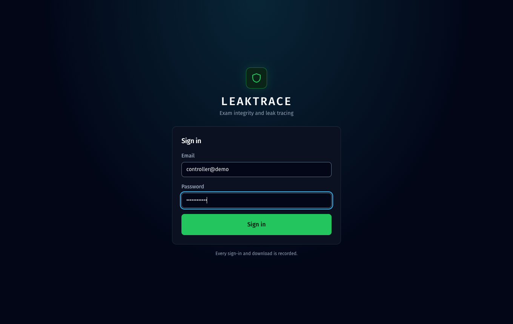 | 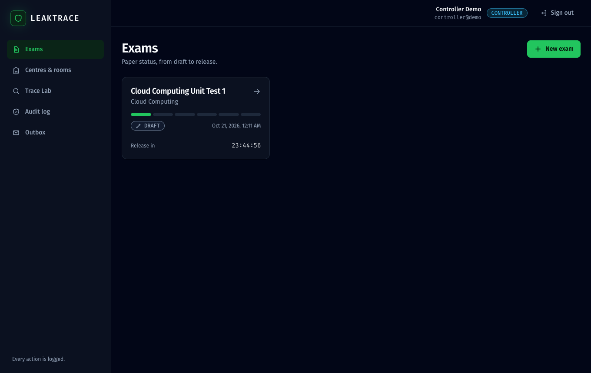 |
| Login | Controller dashboard: status track and countdown to release |
|  | 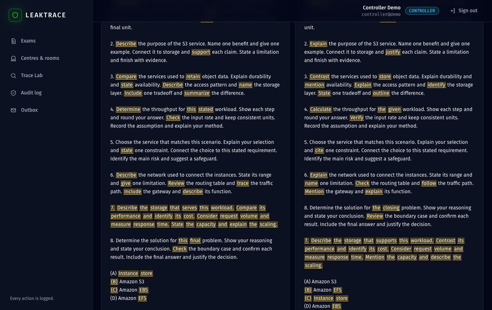 |
| Paper editor: live preview, capacity meter, x / 20 copies | Spot the difference |
| 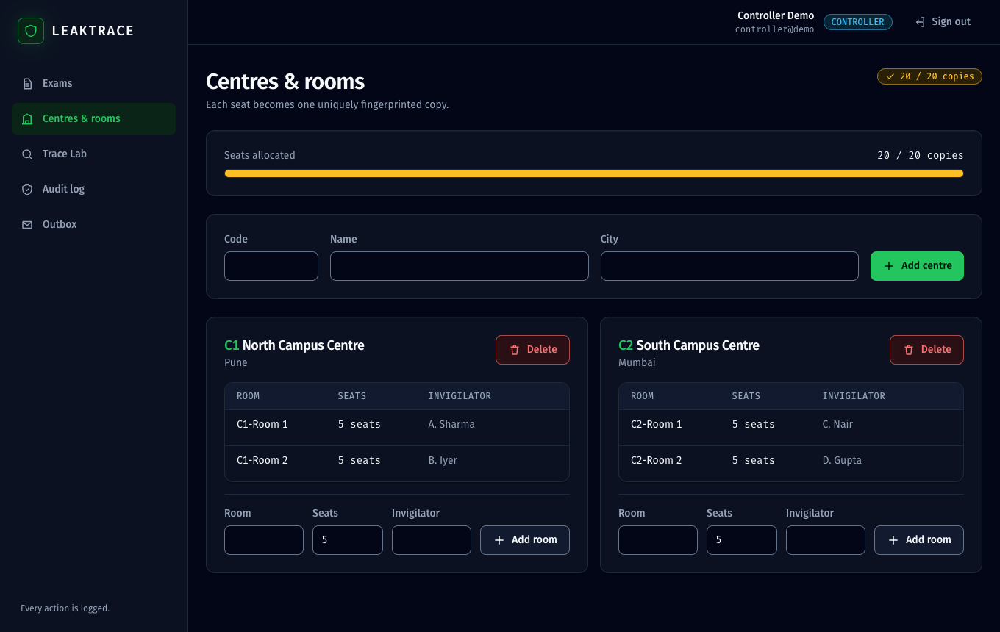 | 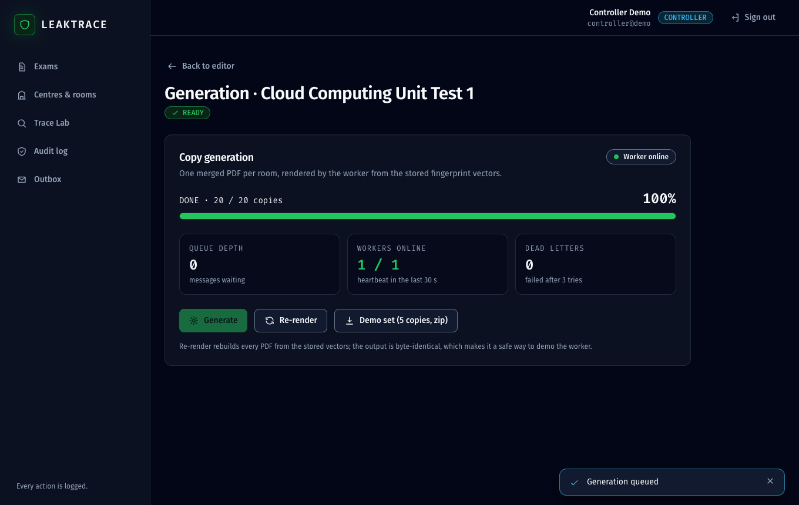 |
| Centres and rooms | Generation monitor |
| 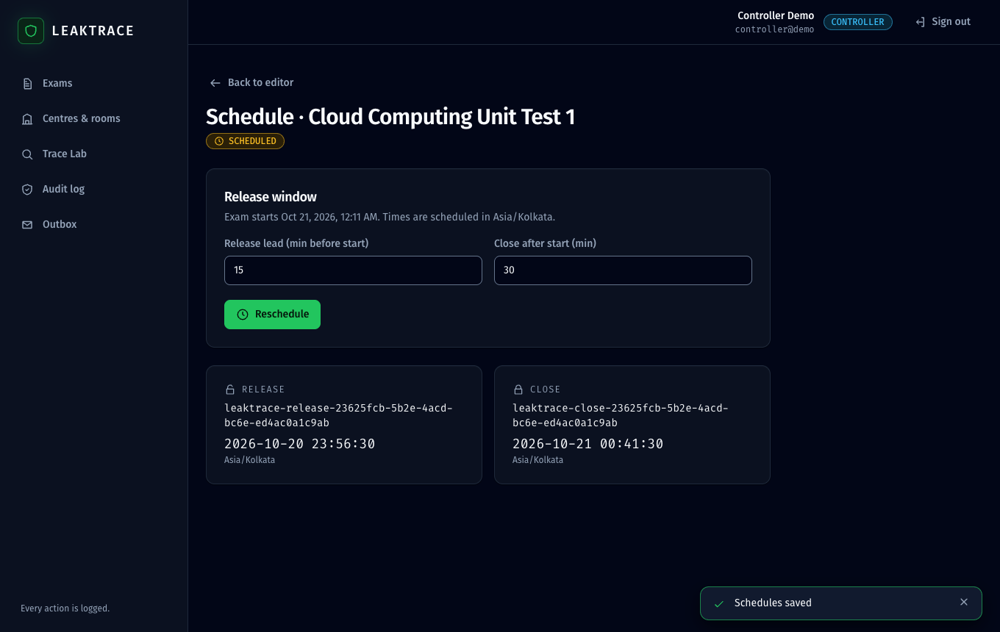 | 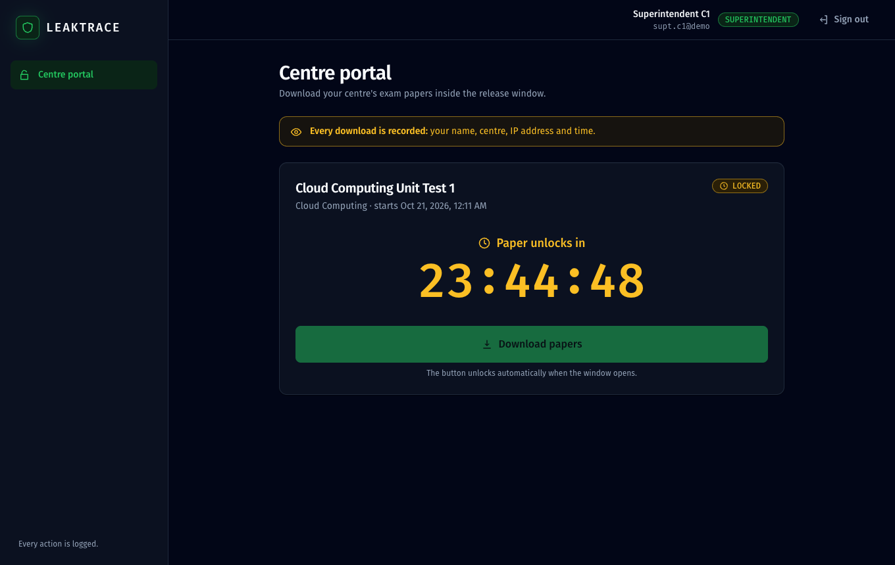 |
| Schedule | Centre portal before the window opens |
| 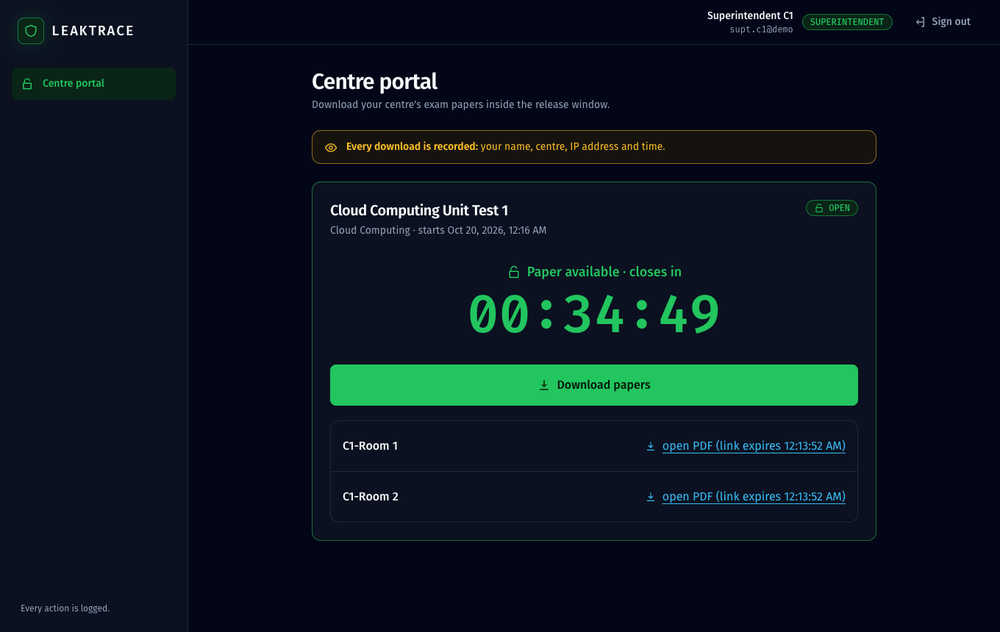 |  |
| Centre portal after release | Trace Lab verdict |
| 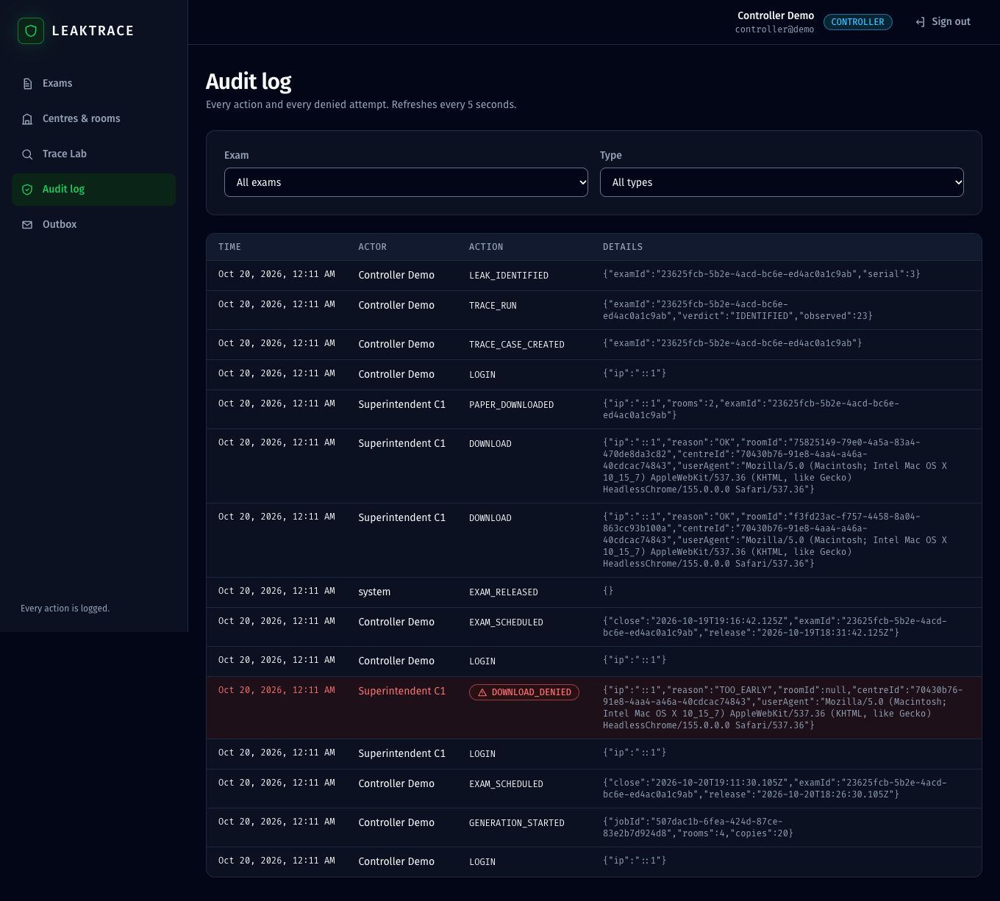 | 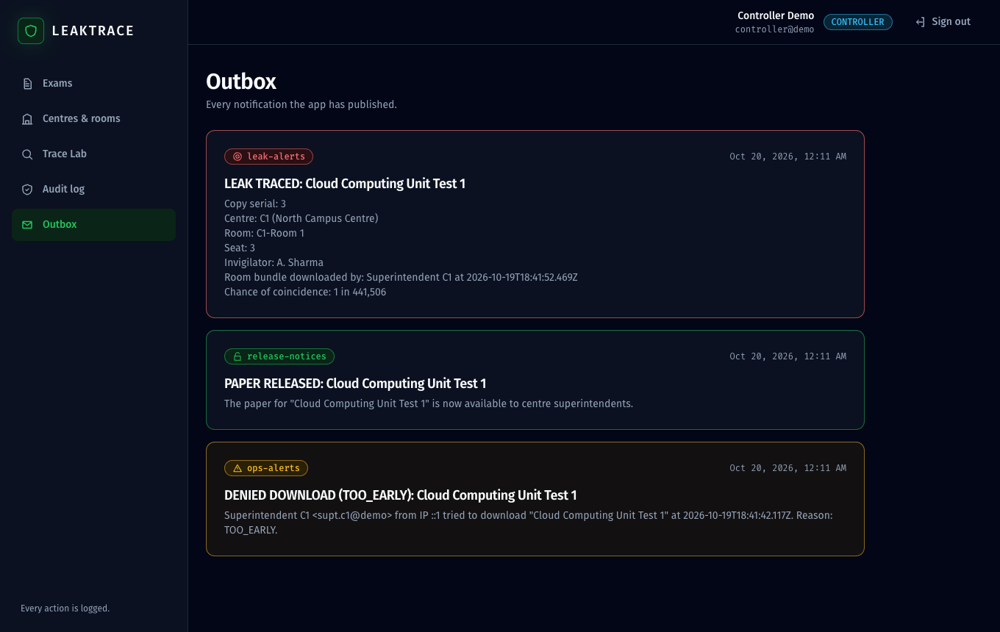 |
| Audit log (denied attempts in red) | Outbox |

Regenerate them with `npm run screenshots`.
