# LeakTrace

**Every printed exam paper is worded differently, so a few leaked lines name the exact copy, centre, room, seat and invigilator.**

[](https://github.com/anjalirawat8181-spec/leaktrace/actions/workflows/ci.yml)
[](LICENSE)


[](https://leaktrace-five.vercel.app)

*The demo runs on free tiers and sleeps when idle, so the first visit can take about a minute to wake. Data resets every night.*

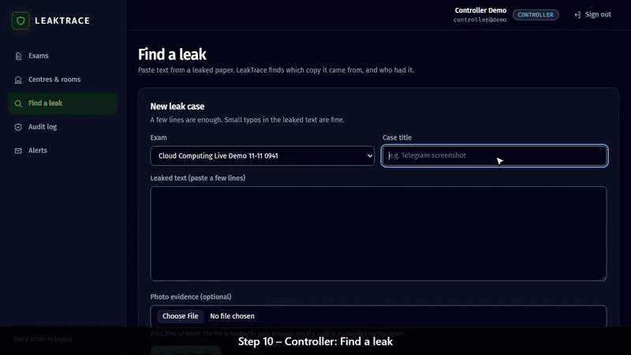

**One click, no account.** The sign-in page has three buttons that sign you in as a seeded demo user:

| Button | You can |
|---|---|
| **Try as Controller** | write a paper, generate copies, schedule the release, and trace a leak |
| **Try as Superintendent** | see "Locked until…" and, inside the window, download the papers for one centre |
| **Try as Auditor** | read the audit log (read only) |

A ready exam with generated copies and a past leak verdict is already there, and a fresh draft exam is waiting for you to play with.

Built by [Anjali Rawat](https://github.com/anjalirawat8181-spec) & [Pranav](https://github.com/08pranav).

---

## The problem

When an exam paper leaks, the usual response is prevention: sealed packets, tighter handling, and, when that fails, cancelling and re-running the exam. Prevention has a weak last mile. Once a paper is printed and opened at hundreds of centres, anyone with a phone can photograph it, and every copy is identical, so a leaked photo tells you nothing about where it came from.

LeakTrace adds accountability for that last mile. Each copy is slightly different, so a leak points back to one copy, one seat and one invigilator instead of to "somewhere among all the centres". Tracing does not replace prevention. It makes leaking risky for the person doing it, and it gives investigators a starting point.

## How the fingerprint works

The controller writes the paper once, marking places where the wording can vary:

```
1. {{Calculate the total|Determine the total}} storage required for {{every virtual machine|each virtual machine}}.
   {{Present your result|Show your result}} clearly and {{include the units|state the units}}. ...
```

Each `{{a|b}}` is a **variation point**. Each copy picks one alternative at every point, and that list of choices is the copy's secret **fingerprint vector** (a position in a list per point). Besides phrases, the template can vary optional commas, number style, the order of MCQ options and the order of questions inside a block. The demo paper has 67 variation points, worth 72.2 bits, and 20 copies need only 16.3 bits. The generator keeps every pair of copies at least 4 choices apart.

Real output from the fingerprint package for the first sentence of question 1:

| Copy | Choices at the first six points | The sentence |
|---|---|---|
| #1 | `[1,0,0,0,0,0]` | *Determine the total storage required for every virtual machine. Present your result clearly and include the units. Use the stated value and verify the calculation…* |
| #2 | `[0,0,1,1,0,0]` | *Calculate the total storage required for every virtual machine. Show your result clearly and state the units. Use the stated value and verify the calculation…* |
| #3 | `[1,1,0,1,0,1]` | *Determine the total storage required for each virtual machine. Present your result clearly and state the units. Use the stated value and check the calculation…* |

**Tracing.** The trace lab takes the leaked text, finds which alternative appears at every variation point it can read, and scores every copy against what it saw. A point whose wording is garbled by a typo is simply not counted, so typos cost evidence but do not mislead. A copy is **named** only when all of these hold: the excerpt has more than one line, enough points were read (at least log2 of the number of copies, plus 2), the best copy disagrees at no more than one of them, and the runner-up disagrees at three or more points beyond that. Otherwise the verdict is *possible* or *insufficient*, with the top candidates listed. The result also reports how likely the match is by chance.

Measured on the demo paper (20 copies; the leak is the first *n* questions of one copy with one deliberate typo in each; three typo variants per copy, 60 trials per row):

| Questions pasted | Variation points seen (average) | Right copy named | Wrong copy named |
|---|---|---|---|
| 1 | 8 | 0 of 60 (a single line is never enough) | 0 |
| 2 | 16 | 60 of 60 | 0 |
| 3 to 8 | 24 to 65 | 60 of 60 in every row | 0 |

Across all 480 trials the tracer never named a wrong copy. This is a measurement on clean text; photos, OCR errors and deliberate rewording are not covered (see *Limitations*). Reproduce it with `npm run build:packages && node scripts/trace-accuracy.cjs`.

## Roles and features

**Controller**
- Writes the paper in the template language, with a live capacity meter and a copies indicator.
- Compares two copies side by side (*spot the difference*).
- Generates one unique PDF per seat; a worker renders the rooms in the background.
- Schedules release and close times in India time and follows a five-step progress bar per exam.
- Uses **Find a leak**: pastes leaked lines (optionally with a photo as evidence) and gets the copy, centre, room, seat, invigilator and who downloaded that room's papers.
- Manages centres and rooms, and can delete an exam (the audit history stays).

**Superintendent** (one per centre)
- Sees only their own centre's exams, with one big status: *Locked until…*, *Download now* or *Closed*.
- Downloads inside the release window through a 120-second signed link; every attempt, allowed or blocked, is recorded.

**Auditor** (read only)
- Browses the append-only audit log, including blocked download attempts.

## Two deployments

The same code runs in two places, selected by `APP_MODE`.

### Live demo (free stack)

[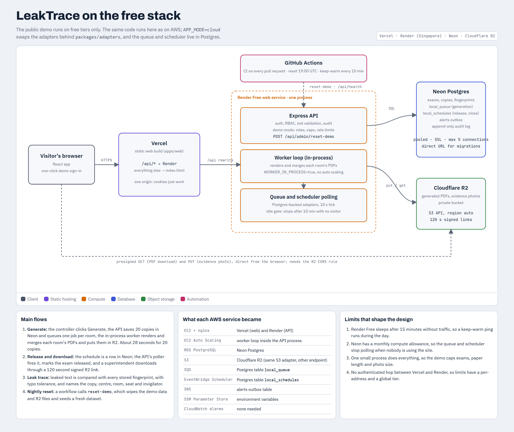](docs/architecture/free-stack.html)

Vercel serves the web app and forwards `/api` to Render, which runs the API and the generation worker in one process. Neon holds Postgres, including the job queue and the release timers. Cloudflare R2 holds the PDFs. GitHub Actions runs CI, resets the demo every night at 00:30 India time and pings the API during the day. Every service, variable and limit is in [infra/free/README.md](infra/free/README.md). Twenty copies generate in about 28 seconds.

### AWS reference deployment

It was deployed in `ap-south-1` (Mumbai) and can be redeployed with [infra/terraform/aws](infra/terraform/aws). The live demo does not depend on it.

[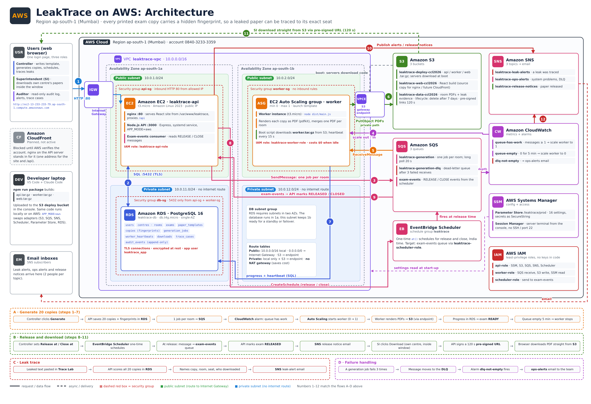](docs/architecture/index.html)

An API server runs nginx and Express; clicking Generate puts one job per room on SQS, a CloudWatch alarm scales a worker from zero, and the worker writes PDFs to S3. EventBridge Scheduler holds the release and close timers, SNS sends alerts by email, and Parameter Store holds the configuration. The measured run, the as-deployed settings and a read-only Terraform plan against the live account are in [docs/aws/](docs/aws/). The video of the live AWS run is described in [demo/field-map.md](demo/field-map.md).

| AWS service | Free-stack equivalent | Why |
|---|---|---|
| EC2 + nginx | Vercel (web) and Render (API) | free static hosting and one free web service |
| EC2 Auto Scaling worker | worker loop inside the API process | Render's free plan has no background workers |
| RDS PostgreSQL | Neon Postgres | free serverless Postgres |
| S3 | Cloudflare R2 | S3-compatible, so the same adapter works with another endpoint |
| SQS | `local_queue` table | the Postgres-backed queue already existed for local mode |
| EventBridge Scheduler | `local_schedules` table and a poller | same |
| SNS | alerts outbox table | no email service in the free stack |
| SSM Parameter Store | environment variables | simplest for one service |
| CloudWatch alarms | not needed | nothing scales |

### Event flows

1. **Generate:** Generate → the API saves the copies and queues one job per room → the worker renders and merges each room's PDFs → they go to object storage → the exam becomes *Ready*.
2. **Release and download:** the controller sets release and close times → a timer fires → the API marks the exam *Released* → the superintendent's button unlocks → a download checks the window and returns a 120-second signed link, and writes a download record.
3. **Trace:** leaked text → fuzzy detection against every stored fingerprint → the verdict, plus a leak alert and audit entries.

## One interface per service, three modes

`packages/adapters` defines small interfaces for everything the app gets from outside: `Storage`, `Queue`, `Scheduler`, `Notifier`, `Metrics`, `Config` and `WorkerFleet`. App code only talks to those. `APP_MODE` picks the implementations:

| `APP_MODE` | Storage | Queue and scheduler | Config | Worker |
|---|---|---|---|---|
| `local` (default) | files on disk | Postgres tables | environment | separate process |
| `aws` | S3 | SQS, EventBridge Scheduler | SSM | Auto Scaling group |
| `cloud` | S3 API against R2 | Postgres tables | environment | inside the API process |

This is why the move from AWS to a free stack was small. Adding `cloud` mode touched 14 source and test files (about 410 lines added, 49 removed, a third of it tests): an optional endpoint on the S3 adapter, a bootstrap that wires the existing Postgres queue and scheduler, and the worker loop moved into its own function so the API can run it. No route and no fingerprint code changed, and one screen changed a sentence.

## Screenshots

Taken on the public demo.

| | |
|---|---|
| 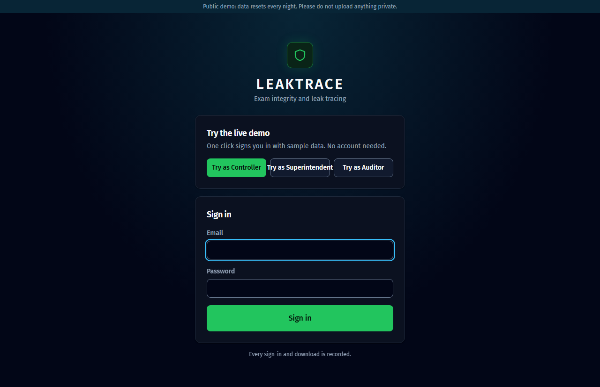 | 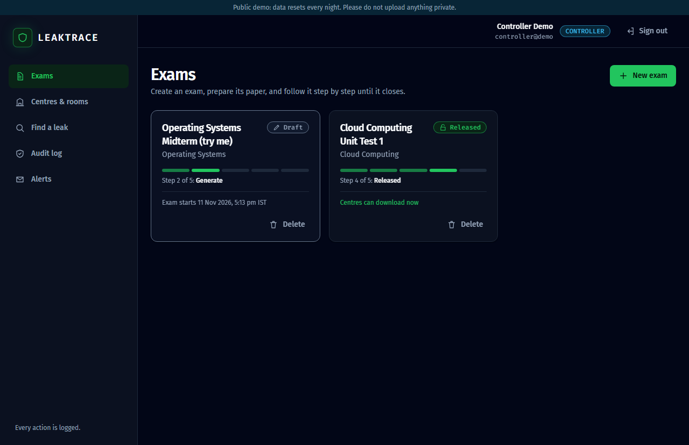 |
| **Sign in with one-click roles** | **Exams, with the five-step bar** |
| 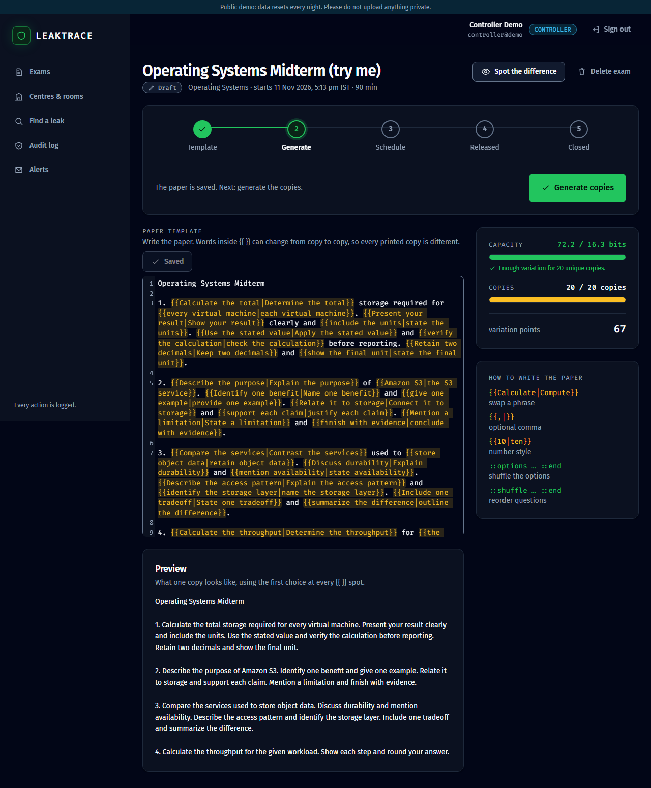 | 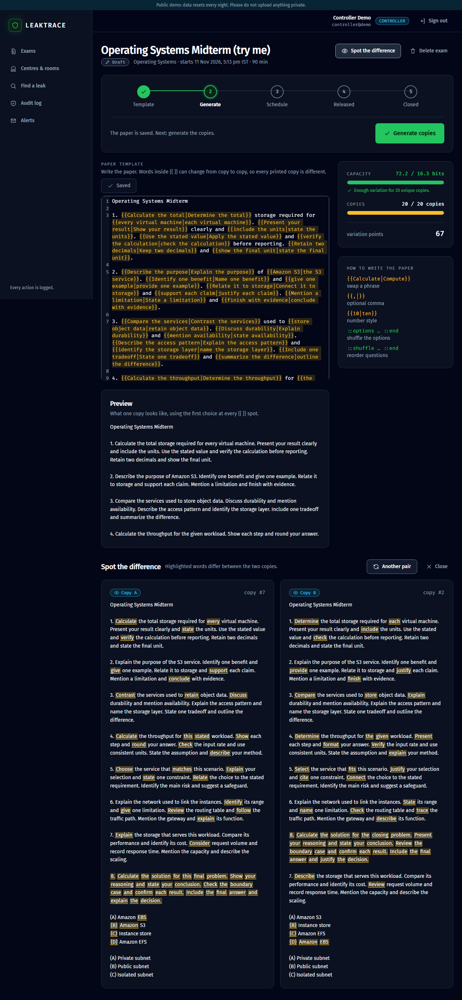 |
| **Paper editor** | **Spot the difference between two copies** |
| 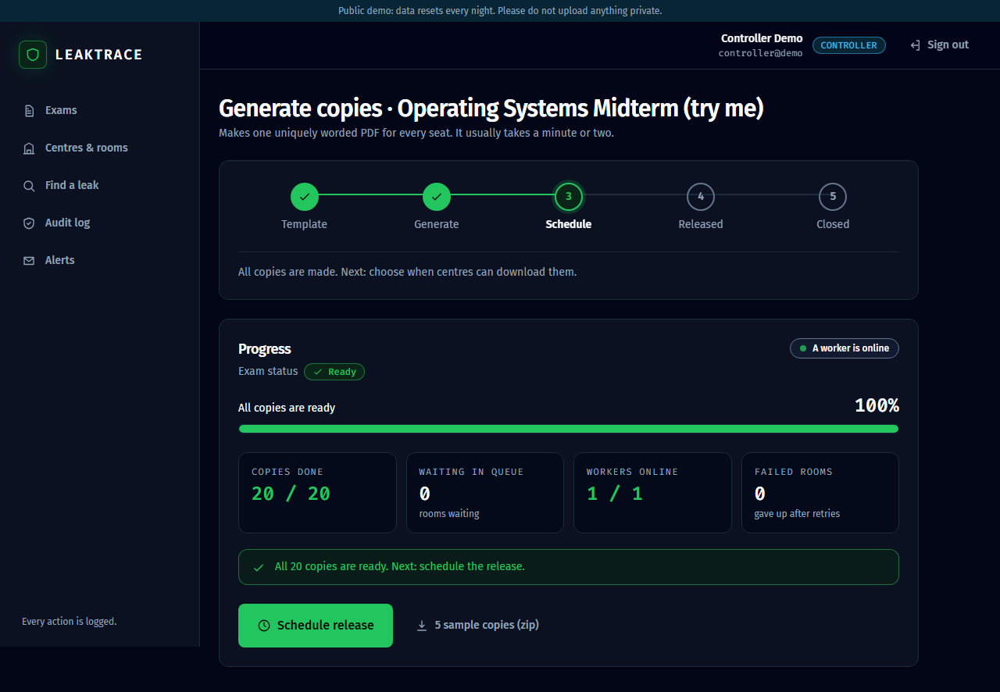 | 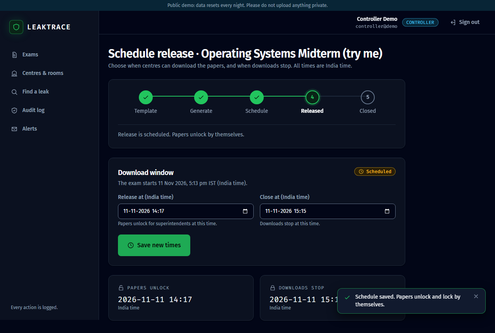 |
| **Twenty copies generated** | **Release and close times, India time** |
| 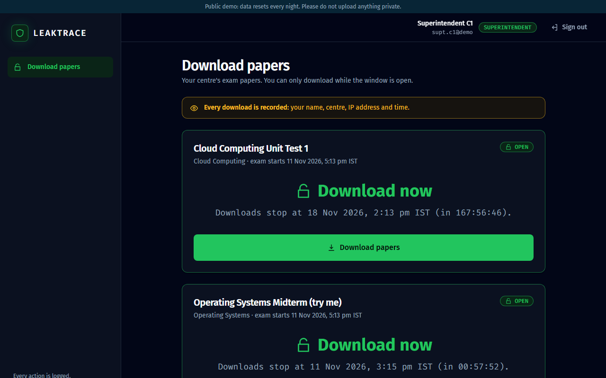 | 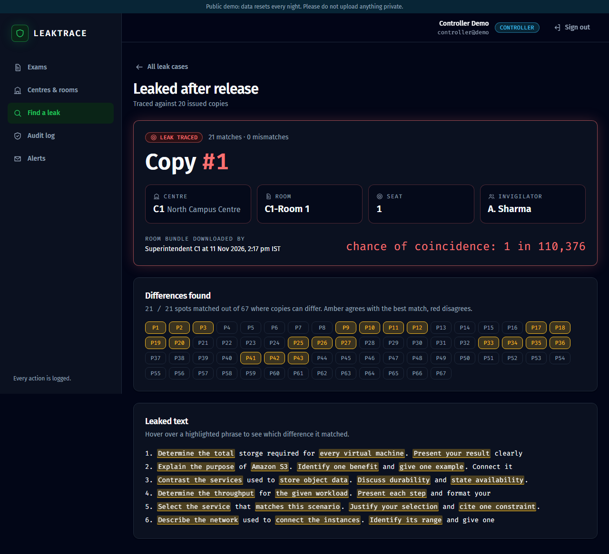 |
| **Superintendent: Download now** | **Find a leak: the verdict** |
| 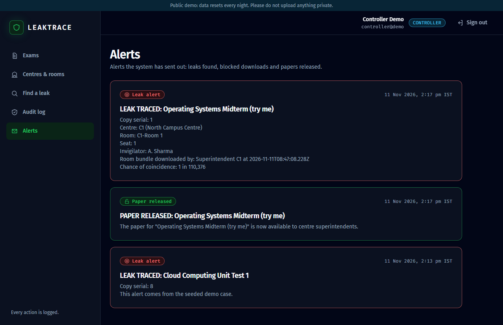 | 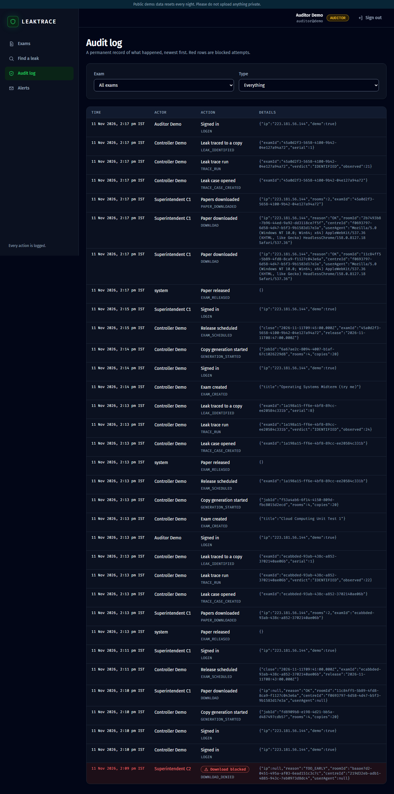 |
| **Alerts outbox** | **Audit log** |

More: [docs/screenshots/aws/](docs/screenshots/aws/) (the AWS site) and [docs/screenshots/after/](docs/screenshots/after/) (local mode).

## Tech stack

TypeScript everywhere. React 18, Vite, Tailwind CSS and TanStack Query on the front end; Express, zod and Postgres on the back end; pdfkit and pdf-lib for the PDFs; vitest and supertest for tests. AWS (EC2 Auto Scaling, RDS, S3, SQS, SNS, EventBridge Scheduler, SSM, CloudWatch) for the reference deployment; Vercel, Render, Neon and Cloudflare R2 for the live demo; GitHub Actions for CI and the nightly jobs; Terraform for the AWS stack.

## Quick start (local)

Needs Node 20+ and Docker.

```bash
git clone https://github.com/anjalirawat8181-spec/leaktrace.git && cd leaktrace
cp .env.example .env      # set JWT_SECRET, FINGERPRINT_KEY and DEMO_PASSWORD; .env is never committed
npm install
npm run dev               # starts Postgres, migrates, builds the packages, then API :4000, worker and web :5173
npm run seed              # once, in another terminal: demo centres, users and an exam
```

Open http://localhost:5173 and sign in as `controller@demo`, `supt.c1@demo`, `supt.c2@demo` or `auditor@demo` with the `DEMO_PASSWORD` from your `.env`. Keep `FINGERPRINT_KEY` stable once copies exist: vectors are recomputed from it.

## Tests

```bash
npm run db:up && npm run db:test   # once: creates the test database
npm test                           # 87 tests: fingerprint 9, pdf 3, adapters 23, web 3, api 20, worker 29
npm run e2e                        # full walkthrough as every role against real processes (about 3 minutes, needs Docker)
```

Database tests skip when Postgres is down. The adapter tests use a mocked S3 client and need no network. CI runs the same steps on every pull request. On Windows, run the tests from PowerShell: under Git Bash, vitest sometimes crashes at start-up with `Cannot read properties of undefined (reading 'config')` (a tooling quirk we have not fixed; a rerun or PowerShell avoids it).

## Project structure

```
apps/web                React + Vite + Tailwind front end
apps/api                Express API: auth, RBAC, schedule consumer, demo mode
apps/worker             Renders and stores each room's PDFs (own process, or inside the API)
packages/fingerprint    Template parser, vector generator, renderer, leak detector (pure code, no I/O)
packages/pdf            pdfkit rendering, pdf-lib merge, answer key, visible code
packages/shared         zod schemas, roles, statuses
packages/adapters       The interfaces and the local, AWS and cloud implementations
db/                     SQL migrations and seed data
infra/terraform/aws     Terraform for the AWS deployment
infra/free              How the free stack is put together
infra/*.sh              EC2 first-boot and redeploy scripts for AWS
scripts/                packaging, local end-to-end run, free-stack deploy, leftovers check
demo/                   scripts that record and assemble the demo videos
docs/                   architecture diagrams, AWS evidence and teardown, deploy notes, showcase
```

## Design decisions and trade-offs

- **Deterministic code only.** Tracing has to be explainable to an investigator: "these 16 spots all agree with copy 2 and none disagree". A model's confidence would not be.
- **The fingerprint key is a secret that must never change.** Vectors are recomputed from `FINGERPRINT_KEY`, and tracing depends on the stored vectors, so rotating the key breaks every existing exam.
- **Fuzzy matching, not exact matching.** Leaks are retyped or photographed, so a copy must still be found with typos. The cost is that very short excerpts give "possible", not a name.
- **One interface per outside service.** Costs a small layer of indirection; it paid for itself when the deployment moved.
- **Postgres as the queue and scheduler in the free stack.** Fewer moving parts and no cost, in exchange for polling. To keep Neon's monthly compute allowance, the polling stops when nobody has used the site for ten minutes, so a scheduled release that comes due while the site is idle fires on the next visit.
- **At most 20 copies per exam** (enforced by the API and by the fingerprint engine), which keeps generation fast on small machines and the fingerprint space comfortable.
- **Append-only audit log.** A database trigger rejects updates and deletes. The nightly demo reset therefore hides old events by time instead of deleting them.

## Security notes

- Role-based access control on every route; every request body is validated with zod; all SQL is parameterised.
- Sessions are signed cookies, `HttpOnly` and `SameSite=Strict`; passwords are hashed with bcrypt; helmet sets the standard headers.
- Papers are downloaded through short-lived signed links (120 seconds), only inside the release window, and every attempt writes a download record, a metric and an alert when blocked.
- The audit log is append-only at the database level.
- Secrets are never in the repository: `.env` is ignored, AWS uses IAM roles and Parameter Store, the free stack uses environment variables.
- The public demo adds rate limits, caps on exams, paper length and photo size, and a bearer-token-protected reset. Behind a proxy chain, the limits trust a fixed number of proxy hops and also have a global cap, because a caller that bypasses the first proxy can still send its own forwarded address.

## Limitations

- Not used on real exams. It is a college project and a reference design.
- The fingerprint lives in wording. Retyping, paraphrasing or comparing several copies can remove it; the more variation points a paper has, the more a leaker has to change.
- Accuracy was measured on clean text. Photos, OCR noise and partial lines are not measured.
- Twenty copies per exam at most.
- The free stack is small: Render sleeps when idle, Neon has a monthly allowance, and a visitor can wait about a minute at the first request.
- The AWS reference deployment serves plain HTTP from one server, has no CloudFront, and its data bucket has no CORS rule for browser photo uploads.
- Leak alerts reach people by email only on AWS; the free stack shows them in the in-app outbox.

## Roadmap

- HTTPS and a CDN in front of the AWS deployment.
- Trace from a photo by reading the text first, and measure accuracy on real photos.
- Make variations harder to normalise away (more points per question, reordering inside answers).
- More than 20 copies per exam.
- Several institutions in one installation.

## More documentation

- [docs/PROJECT_SHOWCASE.md](docs/PROJECT_SHOWCASE.md): a detailed brief of the project, with numbers and the story of the move to the free stack.
- [docs/ARCHITECTURE.md](docs/ARCHITECTURE.md) and [docs/architecture/](docs/architecture/): the AWS write-up and both diagrams.
- [docs/aws/](docs/aws/): inventory, as-deployed notes, the evidence from the demo run, and [TEARDOWN.md](docs/aws/TEARDOWN.md).
- [docs/deploy-notes-aws.md](docs/deploy-notes-aws.md): the original AWS deploy notes and the ten-step live test.
- [docs/report-shots/](docs/report-shots/): the AWS adapter code with captions.

## Credits

Built by **[Anjali Rawat](https://github.com/anjalirawat8181-spec) & [Pranav](https://github.com/08pranav)**.

## License

[MIT](LICENSE)
