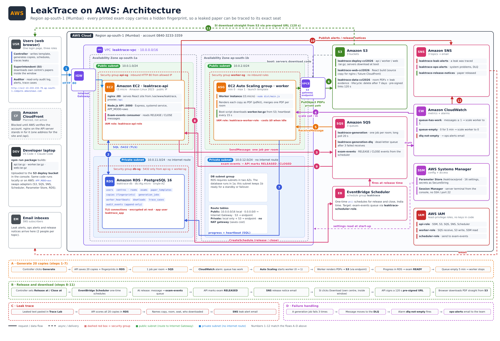

# LeakTrace architecture on AWS

- **Free-stack version:** [`architecture/free-stack.html`](architecture/free-stack.html) shows the same system on Vercel, Render, Neon and Cloudflare R2 (`APP_MODE=cloud`); [PNG](architecture/leaktrace-free-stack-architecture.png).
- **Interactive explorer:** open [`architecture/index.html`](architecture/index.html) in a browser (or via GitHub Pages). Click any service for details, or play the four request flows step by step.
- **Print / zoom:** [`architecture/leaktrace-aws-architecture.pdf`](architecture/leaktrace-aws-architecture.pdf)

LeakTrace prints a slightly different copy of an exam paper for every seat. If a paper leaks, the app compares it with every copy and names the seat it came from. Everything runs in one AWS region, **ap-south-1 (Mumbai)**.

## Network

| Range | What it is |
|---|---|
| `10.0.0.0/16` | VPC `leaktrace-vpc` |
| `10.0.1.0/24` | Public subnet, ap-south-1a: API server |
| `10.0.2.0/24` | Public subnet, ap-south-1b: worker (Auto Scaling may use either public subnet) |
| `10.0.11.0/24` | Private subnet, ap-south-1a: RDS |
| `10.0.12.0/24` | Private subnet, ap-south-1b: second subnet of the DB subnet group |

- Public route table: `0.0.0.0/0` → Internet Gateway. Private route table: local only.
- S3 **gateway endpoint** on both route tables, so S3 traffic stays inside AWS. No NAT gateway (cost).
- Two AZs because an RDS subnet group must span at least two, and so the worker or a standby can run in the other AZ.

## Security groups

| Group | Inbound |
|---|---|
| `api-sg` | HTTP 80 from the allowed IP |
| `worker-sg` | none (outbound only) |
| `db-sg` | 5432 only from `api-sg` and `worker-sg` |

Port 22 is closed everywhere; servers are managed with **Session Manager**.

## Services

| Service | Role in LeakTrace |
|---|---|
| **EC2** `leaktrace-api` (t3.micro) | nginx on :80 serves the React build and proxies `/api` to the Node.js API on :3000; also consumes `exam-events` |
| **EC2 Auto Scaling** (min 0, max 1) | PDF worker: renders each copy, merges one PDF per room, uploads to S3, heartbeats to RDS |
| **RDS PostgreSQL 16** (db.t4g.micro) | users, centres, rooms, exams, copies and fingerprints, jobs, downloads, trace cases, append-only audit log |
| **S3** | `deploy` (code packages), `web` (React build), `data` (PDFs, evidence; 7-day lifecycle; 120 s pre-signed downloads) |
| **SQS** | `generation` (one job per room), `generation-dlq` (after 3 failures), `exam-events` (release / close) |
| **EventBridge Scheduler** | one-time `at()` schedules for release and close (Asia/Kolkata) |
| **SNS** | `leak-alerts`, `ops-alerts`, `release-notices` → email |
| **CloudWatch** | `queue-has-work` → scale worker to 1, `queue-empty` (5 min) → 0, `dlq-not-empty` → ops-alerts |
| **Systems Manager** | Parameter Store `/leaktrace/prod` (16 settings, secrets as SecureString); Session Manager |
| **IAM** | `leaktrace-api-role`, `leaktrace-worker-role`, `leaktrace-scheduler-role`; least privilege, no keys in code |
| **CloudFront** | planned; blocked until the AWS account is verified, so nginx on EC2 stands in |

## Main flows

1. **Generate:** Controller clicks Generate → API saves 20 copies in RDS → one job per room on SQS → CloudWatch alarm starts a worker → PDFs to S3 via the gateway endpoint → exam READY → worker scales back to 0.
2. **Release and download:** Controller sets Release at / Close at → EventBridge Scheduler → `exam-events` → API marks RELEASED → SNS release notice → superintendent downloads via a 120 s pre-signed S3 link.
3. **Leak trace:** leaked text in Trace Lab → API scores all copies against stored fingerprints → names copy, room, seat → SNS leak alert.
4. **Failures:** a job failing 3 times moves to the DLQ → `dlq-not-empty` alarm → ops-alerts email.

## Deploying

`npm run package` builds `api.tar.gz`, `worker.tar.gz` and `web.tar.gz`. Upload them to the deploy bucket. New servers download them at boot (`infra/user-data-*.sh`); the running API server is updated with `infra/redeploy-api.sh` through Session Manager. Setting `APP_MODE=aws` switches every adapter (storage, queue, notifications, scheduler, config) from its local version to its AWS version.
